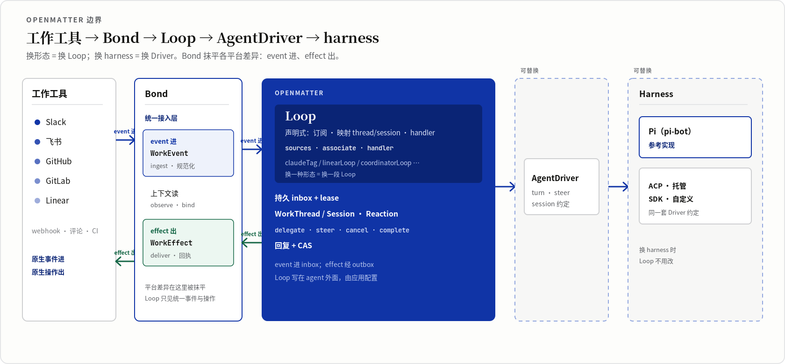
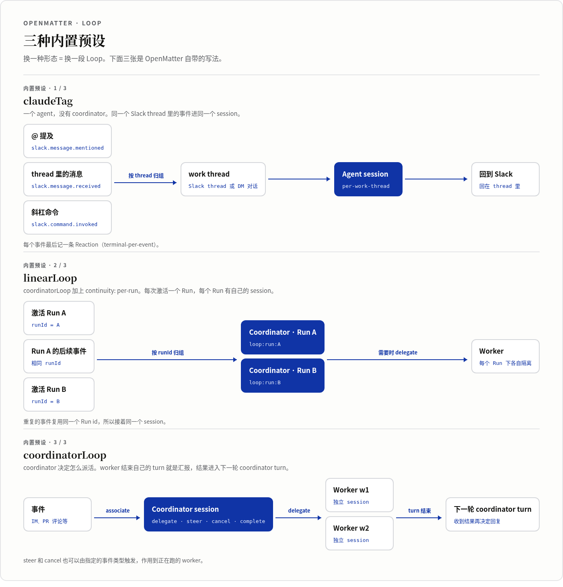
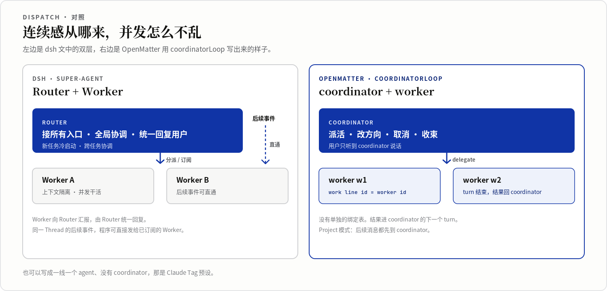
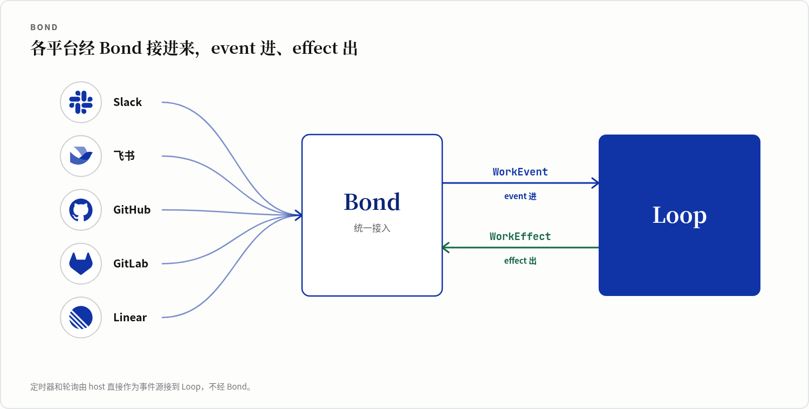
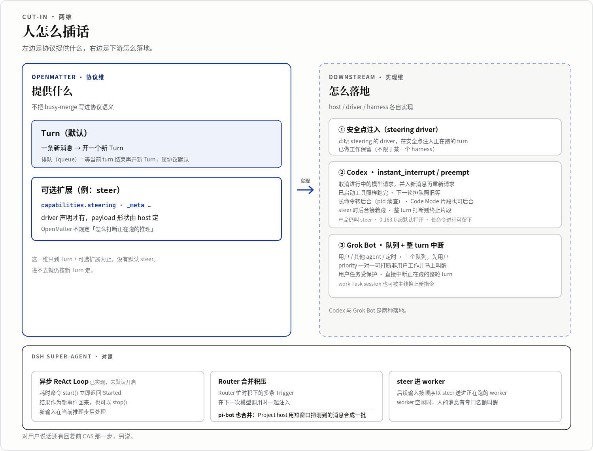
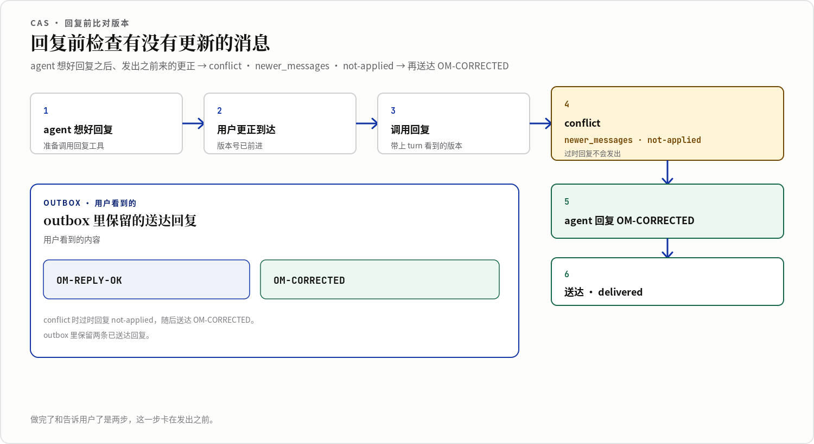
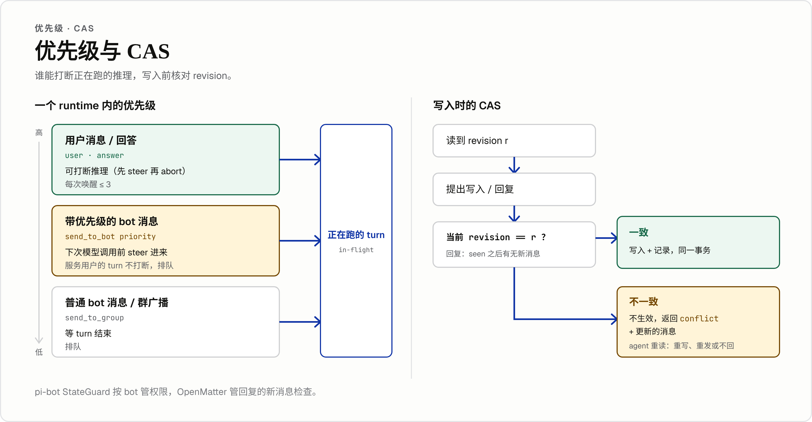

# 用 OpenMatter 在任意 harness 上搭 Super-agent

这篇文章对照的是 DeepSeek Harness 团队的 [Super-agent 设计探索](https://mp.weixin.qq.com/s/zoS7GlReWPhfCjENGxXCdg)和他们公开的原型 [dsh-superagent-prototype](https://github.com/deepseek-ai/dsh-superagent-prototype)。我们这边的代码是 [OpenMatter](https://github.com/openma-ai/OpenMatter)，负责把各个平台的事件接进来、交给任意 harness 处理，以及基于它做的个人 agent [pi-bot](https://github.com/openma-ai/pi-bot)。

现在的 agent 大多以 session 为中心，开一个 session 办一件事。几件事同时在跑，就得靠用户自己来回切换，自己记着每件事到了哪一步。dsh 团队的 Super-agent 文章提出，把用户打交道的对象换成一个长期存在的 agent，session 退到系统内部去。文章举的例子是，用户在 IM 里定了方案 A，后来在 PR 评论里改成方案 B，它能跟上。群里有人报了问题，没人 @ 它，它也会去定位根因并提修复 PR。他们把这样的 agent 归纳成四个特征：

- **连续。** 用户在 IM、GitHub 评论这些平时就在用的地方跟它说话，感觉始终只有一个 agent。
- **高效。** 响应快，能并行完成多个复杂任务，上一个命令或任务没做完也能接受下一条指令。
- **主动。** 持续观察环境事件，不用人逐条吩咐就推进值得处理的事，不需要它的时候保持安静。
- **持久。** 始终在线，接入用户真实的工作环境，长时间运行中出了问题能自己恢复。

难处在于，所有事都堆在一个 session 里，上下文是连贯的，但所有任务只能串行排队。每件事单独开 session，并发是上去了，各任务的结果又互不通气。dsh 团队的出发点是，单任务的上限取决于模型，多任务的上限取决于人的注意力，据他们观察，一个人通常只能同时跟进 3 到 5 个活跃 Session。他们搭了五个模块来撑住上面四个特征，其中部分设计放进了公开的原型：

- **双层架构。** 常驻的 Router 负责接人和派活，Worker 各自干活，用户那边看到的始终像同一个 agent。对应「连续」和「高效」。
- **事件驱动。** 群聊、邮件、代码评审、CI 这些环境事件（文中叫 Trigger）先过滤再派发，同一话题的后续事件可以直接交给已有的 Worker。还可以先在后台试一版（文中叫投机执行，也就是还没人明确说要做，就先在后台试）。对应「主动」。
- **面向人的交互。** 异步 ReAct Loop 让会话不用等任务做完，输出也按 IM、GitHub、邮件各自的习惯来写。对应「高效」。
- **计算、状态与环境的分离。** agent 不用守在一台机器上，换了机器状态也还在。对应「持久」。
- **Watchdog。** 在主系统外面看着 agent 有没有实质进展，没有就把它拉回来。对应「持久」。

已经有很多产品往这个方向走了。Claude Tag 只在 Slack 里，频道里的人都能 @ 它，每个 thread 是一个独立 session，跑起来以后 thread 里谁回复都能中途改它的方向。Linear 的 Agent Session 只在 Linear 里，被 @ 或被指派 issue 时建起一条以该 issue 为中心的 session，活由外部 agent 在自己的 harness 里跑。Claude Projects 处在 public beta 的这一版，入口是一个 Project 窗口，底下给每件事开 thread 并行去做。Grok Bot 的入口是自己的 app 和 Slack，用户消息优先处理，成块的工作再交出去。

上面这几款产品和 dsh 的设计，差别都落在四个决定上：

- **交给谁，接着哪段上下文。** 新事件归到已有的工作线还是另起一条，接着哪个 session 跑，要不要由 coordinator 再往下派。前面说的两难就在这里：session 合得多，上下文连贯，任务却要排队。分得多能并发，结果又互不通气。连续和高效都取决于这一条。
- **事件来了，要不要叫醒 agent。** 没人 @ 的群消息、CI 失败、定时触发，哪些值得处理，哪些只记下来。主动做到什么程度，不需要它时能不能安静，看的是这一条。
- **人中途改了主意，新消息怎么进。** 等这一轮做完再处理，打断它，还是把新消息塞进正在跑的这一轮。方案 A 改成 B 能不能跟上，上一件没做完能不能接下一条指令，看的是这一条。
- **做完了，怎么告诉用户。** 谁来回复，在哪儿回、回多长，旧方向的结果还发不发。用户眼里是不是始终只有一个 agent，看的是这一条。

持久对应的是另一件事，状态放在哪，放到后面单独讲。

OpenMatter 把这四个决定放到 agent 外面。前两个由应用写成一段叫 Loop 的声明（和 agent 内部的 ReAct Loop 不是一个东西），后两个由 OpenMatter 的协议给出默认做法，应用可以在上面改：

- Loop 里定义事件怎样落到工作线，也就是这件事归 coordinator 管还是某个 worker 管，这条工作线接着哪个 session 跑，派出去的任务由哪个 agent 跑。
- Loop 里定义订阅哪些事件，事件来了由 handler 决定处理还是只记下来。
- 新消息默认开一个新的 turn，排在当前这一轮后面。driver 声明自己做得到的时候，也可以打进正在跑的这一轮，普通消息走不走这条路由应用决定。
- 回复是 agent 在 turn 里调用的操作，要不要发、怎么写由 agent 定。发之前先比对对话有没有更新，发完留一张回执。

Slack、飞书、GitHub、GitLab、Linear 之间的差异由各平台的接入层处理掉，Loop 面对的是同一套事件、上下文读取和操作。外部平台和团队自己的 IM 都通过一层叫 Bond 的接入抽象（抹平各平台事件和操作的格式差异）接进 OpenMatter：

- 从 Bond 进来的消息、评论、定时触发，整理成统一格式的工作事件，叫 WorkEvent
- agent 要对外做的事，比如发一条回复，记成 WorkEffect，再经 Bond 发回平台

也就是 event 进、effect 出。

*工作工具进 OpenMatter，Loop 声明对外形态，harness 经 AgentDriver 可换。*

换一段 Loop，对外形态就跟着变。内置的三条预设差在两件事上：有没有一个负责派活的 coordinator，session 怎么分。最简单的没有 coordinator，每个 Slack thread 或私聊就是一个 session，这是 Claude Tag 的样子（claudeTag）。往上一步加一个派活的 coordinator，每次派出去的运行各开一个 session，这是 Linear 的样子（linearLoop）。再往上，coordinator 底下同时挂好几条 thread，每条由一个 worker 跑，做完把结果交回 coordinator，由它决定怎么回复用户，Claude Projects 一个窗口里并行多条 thread 就是这样（coordinatorLoop）。

*Loop 不同，对外形态就不同。三张预设合在一张图里对照。*

这些 Loop 都写在 agent 外面。harness 从另一头通过一层叫 AgentDriver 的接口接进来，背后接 ACP（Agent Client Protocol）、托管 runtime、进程内 SDK 或自定义 agent 都可以，所以换 harness 的时候，这些 Loop 还是那几段。

OpenMatter 开始得比 dsh 那篇文章早一些。2026-08-19 的第一个提交是 README 和一份 brief，同一天我们把 agent 那一侧的边界从 ACP 改成了 driver，这层边界就是现在的 AgentDriver。第二天我们加了 Slack host 和 Claude Tag 风格的 Loop。

下面拿 dsh 团队的 Super-agent 文章的设计和我们的做法放在一起看。先看活由谁来派，也就是 Router 和 Worker 在 Loop 里怎么写。然后看 agent 怎么被事件叫醒，人在工作中途改了主意新消息怎么进来，以及事情做完了和用户知道了之间的那一步。再往后看状态放在哪、旧的内容怎么找回来，最后是几个我们还在想的问题。

## 连续感从哪来，并发怎么不乱

连续和并发不好同时压在同一个 session 上：所有事件都交给一个 Session，上下文最连续，但所有事都要排在一个 ReAct Loop 后面。dsh 团队的 Super-agent 文章的编排是常驻的 Router 接收所有入口的消息并做全局协调，上下文隔离的 Worker 并发干活，Worker 向 Router 汇报，由 Router 统一回复用户。环境事件在文中叫 Trigger，过滤之后才决定要不要叫醒模型。Router 给一条事件流建了 Worker 之后，Worker 订阅这条流，后续事件由程序直接发给它。

OpenMatter 把同样的决定写成 Loop 里可配置的规则。要定的大致是四件事：这条消息归 coordinator 还是某个 worker，什么时候叫醒 agent（也可以只记一条空操作结果就结束，不跑调用），后续消息接着哪一段上下文，以及这一轮 agent 能看到什么、被允许做什么。一次 agent 调用叫 turn，发生在 session 里。把订阅、归属、唤醒和 handler 串起来的，就是开头说的 Loop（和 agent 内部的 ReAct Loop 是两回事。这里说的工作线和 dsh 团队的 Super-agent 文章里的 Thread 也不完全一样：文中的 Thread 多指一条事件流，比如一个 PR，OpenMatter 这边则是决定哪些事件共用一个 session）。

OpenMatter 内置了 coordinatorLoop，由 coordinator 负责分派任务。我们自己的 pi-bot 基于 Pi SDK，是个跟 Grok Bot 类似的多 bot 个人 agent，派任务用的就是这个内置的 coordinatorLoop，所以下面谈分派，都是从 coordinator 的角度来说的。dsh 团队的 Super-agent 文章里的 Router 加 Worker（Router 对应我们这边的 coordinator），可以用 coordinatorLoop 写出来。一个工作线要么是 coordinator，要么是某个 worker。coordinator 可以派活、改方向、取消和收束，简单的 Router 往往只要派活就够。这条预设不限定事件来源，Slack 和 GitHub 的事件可以进同一个 coordinator。worker 通过结束自己的 turn 来汇报，结果进入 coordinator 的下一个 turn。worker 的工作线由 worker 的 id 定死，所以不需要单独的绑定表。

*左边是 dsh 文中的 Router + Worker，右边是用 coordinatorLoop 写出来的 coordinator + worker。*

要并发，也可以一条工作线一个 agent，不要 coordinator。内置的 Claude Tag 预设就是这样，每个 Slack thread 一个 session，几个 thread 各跑各的，互不排队，代价是 thread 之间不共享上下文。飞书和 GitLab 的模板把 session 的范围做成配置项，可以按工作项、按请求，飞书的模板还可以按全局或按用户。

我们的 Project 模式让用户的后续消息都先到 coordinator。pi-bot 打开 Project host 之后，一个 IM thread 对应一个 Project，用户只听到 coordinator 说话。dsh 的做法是 Router 建好 Worker 之后，后续事件直通 Worker。后续消息都先过 coordinator 是有开销的，可以参考 dsh 团队的 Super-agent 文章的消融实验：关掉直通，也就是让后续事件也先过 Router 再转给 Worker，Router 要做的决定和读缓存 token 都明显变多，任务完成时间基本不变（合成负载上的初步结果）。我认为把决定都放在 coordinator 这一处，worker 派错了更容易发现和排查，所以 Project 模式让后续消息都先过 coordinator。想要后续事件直通 worker 的应用，可以在归属规则里把事件映射到 worker。内置的 coordinatorLoop 在 worker 的 turn 结束后会让 coordinator 再跑一个 turn，要省掉这一步或者做文中的多对多订阅，就用 Loop 另写一段。

## agent 怎么被唤醒

环境事件很多，多数不该叫醒模型。dsh 团队的 Super-agent 文章把群聊消息、邮件和日程提醒、评审评论、CI 结果都当作 Trigger，先用来源、群组、白名单这类确定条件过滤，这是快路径，剩下的候选再交给模型判断，这是慢路径。

各平台说话的方式不一样：Slack 的 @提及和私聊、GitHub 的 PR 评论和 CI 结果、Linear 的指派，飞书和 GitLab 也各有一套。Loop 不该去记这些差异，它只要统一的事件和统一的操作。开头说的 Bond 就是干这件事的：我们给 Slack、飞书、GitHub、GitLab、Linear 都写了接入，平台上发生的事从这边进成 WorkEvent，agent 要对外做的事从这边出成 WorkEffect。定时器和轮询不经 Bond，由 host 直接作为事件源接到 Loop 上。

消息进来先落到持久入口，等 host 确认存好了才给平台回 ACK（送达确认），然后再处理事件。这样平台不会以为送到了，本地却把消息丢了。pi-bot 里，入口租约完成只说明消息交到了 Pi 手里，后面处理得怎么样要看 pi-bot 自己的记录。

*五个平台经 Bond 接入，进来的都是 WorkEvent，出去的都是 WorkEffect。*

dsh 把「处理不处理」拆成快慢两层，规则先筛，模型再判断。OpenMatter 没有把这两层写死，处理不处理整个交给开发者定义：一段 Loop 声明自己订阅哪些事件，每个事件进来都交给 Loop 的处理函数，由它决定叫不叫醒 agent、只记录还是马上处理，最后留下一条处理结果。我认为 dsh 的快慢两层也能写成一段 Loop，换一套规则就是换一段 Loop。

- 内置的 Claude Tag 预设按 Slack 消息的标记（直接消息、thread 消息、只做观察）决定唤不唤醒，不唤醒也会留下一条处理结果。
- 没人 @ 的群聊消息可以只记录、本轮不处理，这样 agent 回复前还能看到它们。
- 要模型判断的那一步由 agent 的 turn 来做，在有 coordinator 的形态里就是 coordinator 完整跑一个 turn。
- 定时器、轮询和 webhook 都只是事件来源，主动行为也走同一个 Loop 和同一种处理结果。pi-bot 的定时任务和监控同样是到点或条件满足时起来做事。

dsh 团队的 Super-agent 文章还讲了投机执行：还不确定结果会不会被采用，agent 就根据环境信号在后台先试一版，有价值就交付，没有价值就丢弃。文中举了他们内部用户群的例子：有人在群里反馈问题，大家还在讨论怎么改，agent 已经在后台复现了问题，并提交了修复 PR。如果没复现出来，或者找不到简单的修复，它就一直不出声。我认为放到 Loop 里，这是 coordinator 收到事件后可以做的一个决定，先派一个 worker 去试，结果不要就取消。

要不要把多条事件合并进一次 turn，由应用自己决定。协议默认仍是一个事件开一个 turn。pi-bot 的 Project host 路径会用很短的窗口，把同一个 Project 里刚到的消息合成一批。

## 人中途改主意时，新消息怎么进

上一条还在跑，用户已经改口了。dsh 团队的 Super-agent 文章先用异步 ReAct Loop 把耗时工具改成立刻返回「已启动」，结果稍后再当新事件送回来，这样会话不必卡在上一条命令上。原型的 worker 会把跑满数秒的前台命令转到后台。pi-bot 里也有相近的做法：模型立刻拿到回执，后台 job 完成后再作为一条入口事件回来。

若改主意时 agent 正在跑，新消息怎么进来，要分协议和下游两层看。

协议上，OpenMatter 把每一条新消息都看成一次新的 Turn。排队是协议的默认含义：等当前 turn 结束，再开一个新 turn。排队不会打断正在跑的工作，但问题是用户要是马上喊停，agent 可能还是会先把旧方向做完。pi-bot 排队时分先后：直接发给它的用户消息和对提问的回答最先，然后是其他用户消息和后台 job 结果，再是其他 bot 的消息，定时和监控任务排最后，前台连续处理若干条之后会给后面的来源一次机会。

协议还留了可选扩展：在 driver 声明自己做得到的前提下，把新话在安全的时间点打进正在跑的那一轮，已经做完的步骤还能留着。没有声明时，runtime 可以把这条话排到之后的 turn。coordinator 给 worker 改方向，是应用层对这一能力的用法。普通的人类消息要不要走这条路径，也由应用决定。pi-bot 在 coordinator 忙的时候，会把积压的消息打进当前轮。OpenMatter 不把「怎么合并忙时消息、怎么打断正在跑的推理」写进协议语义。

真正怎么落地，看 host、driver 和 harness。Codex 这边，插进当前这一轮的新消息产品上仍叫 steer。它原本要等模型这次输出完或工具调用结束才交给模型，从 0.163.0 起默认改为：steer 一到就取消正在进行的模型请求，把新消息并进上下文重新请求。已经启动的工具照样跑完，耗时长的命令转到后台接着跑。

Grok Bot 这边是另一套落地。用户、其他 agent、定时任务这三种来源的事会进入三个不同的队列，每次要挑下一件时先看用户队列，再看其他 agent，两边都空了才处理定时任务一类事。排在前面，也还要看能不能抢占。其他 agent 发来的普通消息，要等当前这一轮工作结束。一对一发送时标成优先的消息，能打断对方手上不是用户交代的工作，马上把它叫醒。正在处理的用户任务受保护。这类打断会直接中断正在跑的整轮 turn。交出去的 work agent 还在跑时，用户改了主意，主线也可以打断它这一轮，立刻换上新指令。

pi-bot 的做法分两步。agent 正在跑的时候，用户发来新消息，或者回答了它之前提的问题，这条话先作为 steer 进入当前 session，然后取消正在进行的模型请求，让模型带着新话重新推理。已经启动的工具和后台 job 照常跑，一次唤醒里最多这样取消三次（默认值，可配置）。第二步处理旧方向留下的尾巴：同一段对话里来了更新的用户消息，或者用户明确说取消，原先那条消息引出的后续动作都会被拒绝，排在发件箱里还没发出去的回复标成作废，不再发送。

*左边是协议：新消息默认开新 Turn，steer 是可选扩展。右边是下游落地：安全点注入、Codex 取消当前模型请求并让长工具转后台、Grok Bot 按队列优先级中断整轮 turn。下方单列 dsh Super-agent 的做法：异步 ReAct Loop、Router 合并积压、steer 进 worker。合并这一格里也标了 pi-bot：Project host 用很短的窗口把同一 Project 里刚到的消息合成一批。*

coordinator 可以把新指令打进 worker 正在跑的那一轮，已经做完的步骤还留着。换 harness 时 Loop 不用改，看的是那个 driver 有没有声明上面说的可选能力。

## 做完了，怎么告诉用户

dsh 团队的 Super-agent 文章在第 4.2 节讲的是，什么时候该打扰人、在哪个渠道打扰。worker 不直接对外说话，由 Router 统一回复。IM 里只在需要决策或验收时发通知，给简短结论。GitHub、邮件这类渠道写结构化的完整交付。我们这边同样是 worker 做完之后结果回到 coordinator，由 coordinator 对着上下文决定要不要告诉用户、怎么说。

在这套同款的上下文架构之上，我们在工程上还多做了一步：决定要回复之后，这条话发出去之前会不会已经过时，以及它到底发出去没有。我们早期的飞书模板是在 turn 结束后把 agent 的最后输出直接发出去。这样每个 turn 结束都会往群里发一条，agent 没法选择这次不打扰人，发成多长、什么格式也由不得它，做不到 dsh 说的 IM 里只给简短结论。发送失败了，agent 也看不到。后来把回复改成了 agent 在 turn 里调用的工具，要不要发、怎么写由 agent 决定。发之前先做一次 CAS，发完留一张回执。

发送之前是一次 CAS（compare-and-set）。可以把外部的对话看成一份大的共享状态，agent 每次对外回复，都是往这份状态里写一次 effect，也就是前面说的 WorkEffect。OpenMatter 给每段对话记一个递增的版本号，也记下这个 turn 看到了哪个版本，agent 不能自己申报版本。写入时先比对版本号：期间若有了更新的消息，版本对不上，这次写入就不生效，调用返回冲突，并把那些消息带回给 agent。接下来由模型对着完整对话自己判断：重写、照发，还是不回。检查和调用记录落在同一事务里，发送本身是远程操作，所以这项保证是尽力而为。操作要声明需要 CAS 才会比对，目前声明的是飞书和 pi-bot 的回复操作。

*agent 想好回复后用户的更正到了，OpenMatter 返回冲突，随后更正后的回复送达。*

发送之后是回执。每次调用都有明确的结果，成功、拒绝、失败、不确定或冲突都会记下来。调用记录在投递前就写成处理中，所以投递途中崩溃，重放时会报不确定，不会发第二次。一条回复如果标成提问，送达后还会留一张提问回执，用户的回答到达时绑回这个提问，回答本身还是开一个新 turn。pi-bot 的 ask_user 就是这样接在回复路径上的。agent 结束 turn 却没调回复工具的话，什么都不会发，处理结果里记着它没有回复。coordinator 的提示词也写明，派给 worker 的调用返回的只是回执，结果在之后的 turn 里。

## 状态放在哪

持久的正确性不该绑在某个 agent 私有的 session 上。dsh 团队的 Super-agent 文章第 5 节先把推进 Agent Loop 的计算和持久状态分开，再把 Agent Loop 和执行环境分开。第一步和我们的出发点一致，2026-08-19 的 brief 就写明了这一点。事件、每个 turn 拿到的上下文和输入、权限决定、处理结果、对外操作和投递回执都是 OpenMatter 这边不可变的持久记录，重试和过期的 worker 由租约一类机制处理。对用户来说，这意味着换一个 runtime 之后，coordinator 恢复原来的 Session，事情接着做。

dsh 团队的 Super-agent 文章还讲了上下文怎么组织：很可能用到的信息放进窗口，其余的留在窗口外按需读取，再顺着对象上带的 ID 一跳一跳找回更早的内容，这叫链式召回。pi-bot 送给模型的每条入口消息都带稳定的 id 和回复关系，其他 bot 或 job 发来的消息，还可以在同一个任务里顺着回复链回到最初的用户请求，把那条请求的文字一起带上。后台 job 的结果，agent 先看到开头一段和总长度，再按需翻阅剩下的。OpenMatter 的 Slack 和 Linear 上下文读取也给每条内容稳定的 id，并支持继续往下读。

## 还在想的问题

dsh 团队的 Super-agent 文章最后留了几个开放问题，下面前两个就出自那里，后两个是读这篇文章的设计时想到的。

1. **隔离的实例之间，边界怎么划，又怎么协作？** 我们用作用域和隐私分区划边界，项目上下文默认不会越区。协作这边，bot 之间互发消息走的是同一套排队和打断规则：同一个 runtime 里，用户消息和回答可以打断正在进行的推理，带优先标记的 bot 消息可以在下一次模型调用前打进来（正在服务用户的 turn 除外），普通 bot 消息排到 turn 结束。回复前的版本检查就是上一节说的 CAS：这个 turn 看到的版本已经落后，说明期间来了新消息，这次写入就不生效，新消息带回给模型，由它对着完整对话重新判断。这里只把用户的新消息算作冲突。

 

 *两条规则：只有用户的消息能打断推理，写入时版本对不上就不生效。*

2. **云端 loop 被攻破时，怎么保护所连的设备和凭据？** dsh 团队的 Super-agent 文章指出云端 loop 被攻破时所连的设备都有风险，凭据进了模型上下文也可能泄露。我们把凭据交给 Bond 管。Bond 只记凭据的引用，真正的值放在应用自己的存储里，需要时由解析器取出来，所以用户可以不把凭据放进沙箱。凭据值也不放进事件、上下文、agent 输入、回执和日志，每个 turn 能用的操作也要显式授予。

3. **agent 有没有实质进展，该由谁来判断？** dsh 团队的 Super-agent 文章的回答是主系统外的 Watchdog。我们已经写下来的是恢复规则：入口租约过期后消息可以被重新领取，pi-bot 恢复中断的任务时，只续跑能证明只读的检查点，副作用不明的一律不重放。

4. **Agent Loop 应该跑在云端，还是用户自己的电脑上？** dsh 团队的 Super-agent 文章的设计是 Agent Loop 在云端，用户机器上只跑一个不保存会话状态的轻量进程。pi-bot 的 runtime 跑在用户自己的电脑或远程机器上，模型调用和工具都在这台电脑上。云端的 Projects worker 可以把 agent 绑到本地 runtime，runtime 离线时这个 thread 会明确报错。托管 agent 和沙盒这一侧，我们放在 OpenMA 里设计：算在哪跑、盘怎么留、沙盒什么时候起停，都落在它的工作区策略和沙盒生命周期上。不管最后算在哪边，harness 都还是从 AgentDriver 接到 Loop 下面。事件、处理结果和回执都由 OpenMatter 持久化，沙盒起停或者换一台机器跑，事情都能从这些记录接着往下做，所以这一侧也足够 durable。

## 来源

dsh 团队的 Super-agent 文章：DeepSeek Harness 团队（系统实现与执笔：乔宇嘉），《Super-agent 设计探索：迈向更自主的 Agent 系统》，微信，2026-10-31，https://mp.weixin.qq.com/s/zoS7GlReWPhfCjENGxXCdg。原型：https://github.com/deepseek-ai/dsh-superagent-prototype（6337fc8）。文中 Router 批处理（到达速率约 1→40 条/分钟、batch 1.0→2.8、单决定约 6.4→1.6 秒）与关掉直通的消融（决定约 +30%，读缓存 token 2323 万→3177 万）均出自该文实验节。

代码与实现名：https://github.com/openma-ai/OpenMatter、https://github.com/openma-ai/pi-bot。正文写的 Loop / AgentDriver / turn，在仓库里对应 Loop 定义字段（如 sources、associate、scopeId、workThreadId）、Reaction、WorkEvent / WorkEffect、Bond 接入、capabilities.steering 与 _meta、AgentDriver.steer、飞书模板与 pi-bot 回复路径上的 CAS 版本检查（conflict / newer_messages）、投递回执枚举、ask / expectReply 与 ask_user（#56）、inbox 租约与 fence、以及 fig-layering 图中的 Bond 标注。pi-bot 侧还包括 Project host 开关、preemptInference、outbox 作废、入口合并窗口等，详见仓库。OpenMatter 将回复改为 turn 内工具、并加上发送前 CAS 与发送后回执的相关改动见 2026-10-18 前后的 #35、#37、#39。

产品材料：Claude Tag 的记忆分层（组织 / workspace / 私有频道）见 Anthropic 说明。Linear Agent Session 的 webhook 通知、activity 写回、agent 目录（Cursor、Codex、Devin 等）见 Linear 文档。Claude Projects（public beta）的仓库 / 文件 / 指令 / 记忆与并行 thread 见 Anthropic 说明。Grok Bot 0.18 非官方还原里有 executor subagent 与三队列调度。Codex rust-v0.163.0 起默认打开 instant_interrupt（代码里称 preempt），长工具转后台与 Code Mode 见 Codex 仓库与发布说明。
